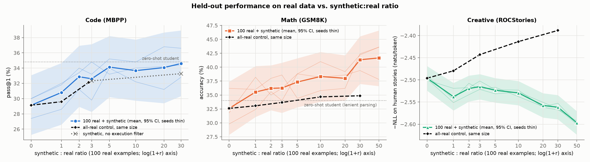
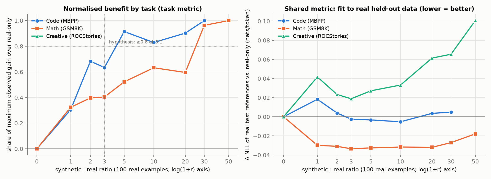
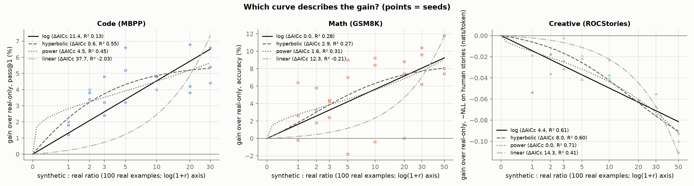
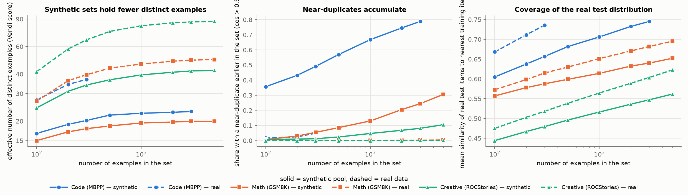
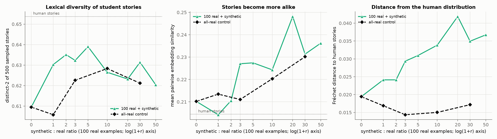

# The Synthetic Data Ceiling: Diminishing Returns from Model-Generated Training Data

## 1. Executive Summary

**Question.** When a small real training set (100 examples) is topped up with data written by a stronger
model, how does performance on real held-out data change with the synthetic:real ratio (0 → 50:1), and does
the answer differ between code generation, math reasoning, and creative writing?

**Answer.** The hypothesis is mostly **not supported** as stated. There is no single "ceiling"; the three
domains behave differently, and which metric you look at matters.

- **Returns diminish, but 3:1 does not capture 80% of the benefit.** At 3:1 the student had 63% of its
  maximum observed gain on code (95% CI 13–100%) and 40% on math (CI 6–64%, which excludes 80%). For
  creative writing no ratio beat real-only training, so the share is undefined.
- **Beyond 10:1 the picture splits by domain.** Code pass@1 is flat (30:1 minus 10:1: +0.9 points, CI −1.6
  to +3.6). Math accuracy is still rising at 30:1 and 50:1 (+3.0 and +3.3 points over 10:1, neither
  individually significant). Creative fit to human text gets steadily worse (every step significant).
- **On a metric shared by all three tasks — loss on real held-out references — everything gets worse past
  10:1**, by small but statistically reliable amounts for code and math and by large amounts for stories.
  The best ratio on this metric was 10:1 for code, 3:1 for math, and 0 (no synthetic data) for creative.
- **Mode collapse in the generator is real and severe**, and is the most robust finding. In a 3,000-example
  synthetic code pool 44% of task descriptions are exact duplicates and 79% have a near-duplicate; 24% of
  synthetic math problems star someone called "Sarah". Effective diversity saturates at roughly half the
  level of real data. The student inherits these modes: "Sarah" appears in its stories 15× more often
  after 30:1 training than after real-only training.
- **Domain ordering:** creative writing degrades earliest (immediately), as hypothesised. Code is *not*
  clearly the most resilient: it saturates earliest (≈5:1) and then neither gains nor loses, while math is
  the domain that keeps benefiting from large ratios.

**Practical implication.** For verifiable skills (code, arithmetic reasoning) extra synthetic data is cheap
insurance that does not hurt task accuracy up to 30–50:1, but most of the code benefit is in by ~5:1. For
open-ended generation, where the goal is to match a human distribution, synthetic data from a single
generator hurt at every ratio tested, and 100 more real examples were worth more than 5,000 synthetic ones.

**Scope warning.** One teacher (Qwen2.5-3B), one student (Qwen2.5-0.5B, LoRA), one real-set size (100), three
seeds, 500 test items for the accuracy metrics. Accuracy differences of under ~4 points between adjacent
ratios are within noise. Details in §6.

## 2. Research Question & Motivation

**Hypothesis under test.** "Performance gains from synthetic data follow a logarithmic curve, with 80% of
maximum benefit captured by a 3:1 synthetic-to-real ratio. Beyond 10:1, performance plateaus or degrades due
to mode collapse in the synthetic distribution. Code generation is most resilient to high synthetic ratios
while creative tasks degrade earliest."

Decomposed into testable parts:

| | Claim | Test |
|---|---|---|
| H1a | gain(r) is logarithmic | AICc comparison of linear, log, power-law, hyperbolic and exponential-saturation fits |
| H1b | ≥80% of max gain at 3:1 | share of maximum observed gain at 3:1, bootstrap CI |
| H2a | plateau or degradation beyond 10:1 | paired contrasts 30:1 vs 10:1 (and 50:1), slope on ln r for r ≥ 10 |
| H2b | caused by mode collapse | diversity of the synthetic pool vs. real data as size grows; student output modes |
| H3 | code most resilient, creative earliest to degrade | cross-task comparison of the above |

**Why it matters.** Generating data costs money linearly in the ratio. A measured dose–response curve per
task family tells practitioners where to stop.

**Gap.** Model-collapse studies (Shumailov et al.; Alemohammad et al.; Gerstgrasser et al.; Dohmatob et al.)
concern *recursive* multi-generation training. Synthetic-augmentation studies (He et al.; Azizi et al.; Fan et
al.; ZeroGen; Yu et al.; Li et al.) each cover one task family with their own generator and metric. This
study runs one protocol across three task families with a real-data control and a direct measurement of the
proposed mechanism. (The pipeline's literature-gathering stage was skipped for this run; the related work is
cited from memory — see `resources.md`.)

## 3. Experimental Setup

### Pipeline
```
100 real examples ──► teacher (few-shot, 3 random real examples per request) ──► synthetic pool
100 real + r×100 synthetic ──► LoRA fine-tune student ──► evaluate on REAL held-out test data
```

### Models
| Role | Model | Settings |
|---|---|---|
| Teacher / generator | `Qwen/Qwen2.5-3B-Instruct` (vLLM 0.30, bf16) | temperature 1.0, top-p 0.95, max 512 new tokens |
| Student | `Qwen/Qwen2.5-0.5B-Instruct` | LoRA rank 32, α 64, all attention + MLP projections (17.6 M trainable params); AdamW lr 1e-4, weight decay 0.01, batch 8, 10% warm-up + cosine, max(2 epochs, 100 steps), max length 448 |
| Embeddings | `all-MiniLM-L6-v2` | diversity and Fréchet-distance metrics |

Checkpoint selection: validation loss on a small **real** validation set is measured 6 times per run and the
best checkpoint is evaluated (so small training sets are not penalised by over-training). Decoding: greedy
for code and math; sampling (T=1, top-p 0.95) for stories. No API models were used — no API key was present
in the environment — so API cost is $0.

Teacher vs. student on the same test items (zero-shot): MBPP pass@1 57.4% vs 34.8%; GSM8K 85.0% vs 34.0%
(lenient answer parsing, 256-token cap). The teacher is clearly stronger.

### Tasks and data
| Domain | Real dataset | Real seed set | Validation | Test | Task metric |
|---|---|---|---|---|---|
| Code | MBPP | 100 of 374 train | 90 | 500 | pass@1 (hidden asserts executed) |
| Math | GSM8K | 100 of train | 200 | 500 (accuracy), 1,319 (loss) | exact match of the number after `####` |
| Creative | ROCStories 2018, title → five-sentence story (human-written) | 100 | 200 | 1,000 (loss), 500 titles (generation) | loss on human stories; Fréchet distance and diversity of sampled stories |

Shared metric for all tasks: per-token negative log-likelihood (NLL) of the real held-out reference answers.

### Conditions
- **Ratio sweep:** r ∈ {0, 1, 2, 3, 5, 10, 20, 30} for all tasks, plus 50 for math and creative.
- **All-real control:** the same total training-set size, all real data (math, creative: r ∈ {1, 3, 10, 30};
  code: 1 and 2.74, i.e. all 374 MBPP training problems).
- **Zero-shot student**, **teacher zero-shot**, and an **ablation** without the execution filter on code.
- 3 seeds. Each seed has its own 100 real examples **and its own independently generated pool**; training
  sets are nested (the 1:1 set is a prefix of the 3:1 set, and so on). 117 runs in total.

### Synthetic pools
| Task | Requests per seed | Usable | Filter |
|---|---|---|---|
| Code | 7,000 | 3,527–3,830 (51–55%) | must parse and pass the teacher's own three asserts |
| Math | 5,200 | 5,166–5,174 (99%) | must parse with a numeric `####` answer |
| Creative | 5,200 | 5,197–5,199 (~100%) | must parse |

Pools are **not** de-duplicated: duplication is part of the phenomenon under study. Prompts are in
`src/generate_synth.py` (`INSTR`).

### Statistics
Two-level paired bootstrap (resample seeds, then test items; 4,000 replicates) for confidence intervals and
two-sided p-values; Holm correction across the three tasks for each planned contrast. Curve models are fitted
to seed-level gains and compared with AICc.

### Compute
4× RTX A6000 (48 GB), **shared with four other jobs at ~100% utilisation**; typically 5–20 GB free per card.
Student runs peaked at 9.0 GB; 117 runs took 9.2 worker-hours (wall-clock ≈2 h with up to 5 workers). Pool
generation: ~52,000 teacher requests, ≈35 min on three partial GPUs.

### Deviations from the pre-registered plan
Made before any reported result was produced, and logged in `planning.md`: teacher 7B → 3B and student full
fine-tuning → LoRA (both forced by shared-GPU memory), ratio grid capped at 30:1 for code (pool yield),
500-item generation evaluation.

## 4. Results

### 4.1 Dose–response on real held-out data



Mean of 3 seeds; brackets are 95% bootstrap CIs. "Share" is the share of the maximum observed gain.

| Ratio | Code pass@1 (%) | share | Math accuracy (%) | share | Creative NLL on human stories ↓ |
|---|---|---|---|---|---|
| 0 (real only) | 29.1 [25.3, 33.1] | 0 | 32.6 [27.9, 37.4] | 0 | **2.496** |
| 1:1 | 30.8 | 0.30 | 35.5 | 0.32 | 2.538 |
| 2:1 | 32.9 | 0.68 | 36.2 | 0.40 | 2.520 |
| 3:1 | 32.6 [28.3, 37.1] | 0.63 | 36.3 [31.8, 40.8] | 0.40 | 2.515 |
| 5:1 | 34.1 | 0.91 | 37.3 | 0.52 | 2.523 |
| 10:1 | 33.7 [29.7, 37.7] | 0.83 | 38.3 [33.8, 42.7] | 0.63 | 2.529 |
| 20:1 | 34.1 | 0.90 | 38.0 | 0.60 | 2.558 |
| 30:1 | **34.6** [30.3, 38.9] | 1.00 | 41.3 [37.0, 45.5] | 0.96 | 2.562 |
| 50:1 | – | – | **41.7** [36.6, 46.6] | 1.00 | 2.597 |
| *All-real control, 3:1 size* | 32.1 (at 2.74:1) | | 33.7 | | 2.443 |
| *All-real control, 30:1 size* | – | | 34.9 | | 2.388 |
| *Zero-shot student* | 34.8 | | 34.0 (lenient parsing) | | 2.908 |

Full tables, per-seed values and all confidence intervals: `results/tables.md`.

### 4.2 Planned contrasts (task metric)

| Task | 3:1 − real-only | 10:1 − 3:1 | 30:1 − 10:1 | 50:1 − 10:1 |
|---|---|---|---|---|
| Code (points) | +3.5 [+0.7, +6.5], p_Holm = 0.033 | +1.1 [−1.9, +3.8], n.s. | +0.9 [−1.6, +3.6], n.s. | – |
| Math (points) | +3.7 [+0.6, +6.8], p_Holm = 0.033 | +2.1 [−3.0, +6.7], n.s. | +3.0 [−1.0, +7.3], n.s. | +3.3 [−1.6, +8.4], n.s. |
| Creative (−NLL) | −0.019 [−0.031, −0.004], p_Holm = 0.033 | −0.014 [−0.021, −0.007], p < 0.001 | −0.032 [−0.044, −0.016], p < 0.001 | −0.067 [−0.074, −0.060], p < 0.001 |

Slope of performance per unit ln(ratio) for r ≥ 10: code +0.8 points [−1.5, +3.3]; math +2.4 points
[−0.8, +5.8]; creative −0.040 nats [−0.044, −0.033].

### 4.3 Shared metric: loss on real held-out references



| Task | Best ratio (share of bootstrap resamples) | 30:1 − 10:1 (nats/token) | 30:1 − real-only |
|---|---|---|---|
| Code | 10:1 (85%) | +0.0100 [+0.0037, +0.0183], p < 0.001 | +0.0048 [−0.0018, +0.0119], n.s. |
| Math | 3:1 (61%) | +0.0046 [+0.0025, +0.0069], p < 0.001 | −0.0270 [−0.0521, −0.0067], p < 0.001 |
| Creative | 0 (99%) | +0.0322 [+0.0158, +0.0442], p < 0.001 | +0.0654 [+0.0551, +0.0756], p < 0.001 |

On this metric all three tasks show an interior optimum followed by degradation. For code and math the
degradation is small (≤0.01 nats); for stories it is an order of magnitude larger.

### 4.4 Functional form



ΔAICc (0 = best) and R² for fits to seed-level gains:

| Task | linear | log | power | hyperbolic | exp. saturation |
|---|---|---|---|---|---|
| Code | 37.7 (−2.03) | 11.4 (0.13) | 4.5 (0.45) | 0.6 (0.55) | **0.0 (0.56)** |
| Math | 12.3 (−0.21) | **0.0 (0.28)** | 1.6 (0.31) | 2.9 (0.27) | 4.1 (0.23) |
| Creative (gain is negative) | 14.3 (0.41) | 4.4 (0.61) | **0.0 (0.71)** | 8.0 (0.60) | 9.4 (0.57) |

(The figure omits the exponential-saturation curve, which nearly coincides with the hyperbolic one.)

### 4.5 Mechanism: diversity of the synthetic pools



Mean over the three pools; "Vendi" is an effective number of distinct examples in embedding space.

| Task | Source | n | Exact duplicates | Near-duplicates (cos > 0.9) | Distinct bigram ratio | Vendi | Coverage of real test set |
|---|---|---|---|---|---|---|---|
| Code | synthetic | 300 | 22% | 49% | 0.21 | 20.2 | 0.657 |
| Code | synthetic | 3,000 | 44% | 79% | 0.08 | 23.1 | 0.745 |
| Code | real | 300 | 0% | 5% | 0.37 | 37.0 | 0.736 |
| Math | synthetic | 300 | 0% | 5% | 0.43 | 17.9 | 0.588 |
| Math | synthetic | 5,000 | 0.2% | 31% | 0.15 | 19.9 | 0.652 |
| Math | real | 5,000 | 0% | 0.4% | 0.39 | 49.6 | 0.695 |
| Creative | synthetic | 300 | 0% | 1% | 0.62 | 34.1 | 0.480 |
| Creative | synthetic | 5,000 | 0% | 11% | 0.30 | 42.2 | 0.562 |
| Creative | real | 5,000 | 0% | 0.0% | 0.42 | 86.9 | 0.623 |

Concrete modes (seed-0 pools): `factorial` is the function in 523 of 3,626 usable code examples (14%),
`fibonacci` in 197; 1,232 of 5,174 math problems (24%) begin with "Sarah"; story titles concentrate on "The
Book Swap" / "Book Swap" (257), "Birthday Surprise" (159), "Lost Key" / "The Lost Key" / "Lost Keys" (256).

Going from 300 to 3,000–5,000 synthetic examples raises the effective number of distinct examples by only
14% (code), 11% (math) and 24% (creative). Synthetic data needs roughly 5–10× as many examples as real data
to reach the same coverage of the real test set (math: synthetic 5,000 → 0.652 vs real 1,000 → 0.651; code:
synthetic 3,000 → 0.745 vs real 300 → 0.736).

### 4.6 Creative: what the student writes



| Condition | distinct-2 | Mean pairwise similarity | Fréchet distance to human stories | Exactly five sentences |
|---|---|---|---|---|
| Human stories | 0.654 | 0.204 | 0.013 (noise floor) | 99.8% |
| Real only (r = 0) | 0.610 | 0.210 | 0.019 | 69% |
| Synthetic 3:1 | 0.632 | 0.227 | 0.029 | 77% |
| Synthetic 30:1 | 0.631 | 0.231 | 0.035 | 70% |
| Synthetic 50:1 | 0.620 | 0.236 | 0.037 | 77% |
| All-real control, 30:1 size | 0.621 | 0.230 | 0.017 | 98% |

Mode inheritance (seed 0, 500 stories each): occurrences of the name "Sarah" — human test stories 8; first
500 synthetic stories 375; student after real-only training 11; student after 30:1 training 171; student
after the all-real control 13.

Example, title "Kitchen Table":
- Human-data student (all-real control): *"Jane was creating a remodel for her home. She wanted to make the
  kitchen. She did a great job with the room. She showed her neighbors. They said the kitchen looked pretty."*
- 30:1 synthetic student: *"At the kitchen table, Sarah decided to bake a cake. She placed all her
  ingredients on a rimmed baking sheet. Unexpectedly, the hot baking sheets melted away. Relieved, she let
  the cake cool, then took a photo to show her husband."*

### 4.7 Error analysis

- **Code.** Failures are dominated by wrong answers (AssertionError 52–55% of items at every ratio). Synthetic
  data mainly reduces "other runtime errors" (4.6% → 2.5%) and wrong answers (55.0% → 51.9%); syntax errors
  stay near 1%. The zero-shot student makes more syntax errors (5.0%) but fewer wrong answers (48.0%).
- **Math.** Almost all failures are wrong final answers (66% at r = 0 → 55% at 50:1). Format failures (no
  `####` line) stay at 1–6%.
- **Execution-filter ablation (code).** Without the filter: 32.3% at 3:1 and 33.3% at 30:1, versus 32.6% and
  34.6% with it. The per-seed differences at 30:1 go both ways (+0.2, −1.4, +5.2 points), so this is
  inconclusive.

Raw outputs for every run: `results/model_outputs/*.json.gz`; run log: `results/runs.jsonl`.

## 5. Analysis & Discussion

### Verdict per sub-hypothesis

| | Claim | Verdict | Evidence |
|---|---|---|---|
| H1a | Gains are logarithmic | **Partly.** Math only | Log is the best model for math, but explains little variance (R² 0.28). Code is better described by a bounded saturating curve (log is 11 AICc units worse). Creative "gains" are negative |
| H1b | 80% of benefit by 3:1 | **Not supported** | Code 63% (CI 13–100%; 80% reached at about 5:1). Math 40% (CI 6–64%). Because the math curve is still rising at the edge of the grid, 40% is an upper bound |
| H2a | Plateau or degradation beyond 10:1 | **Depends on domain and metric** | Code accuracy: plateau. Math accuracy: no plateau detected up to 50:1 (but the test cannot exclude one). Creative: degradation. Loss on real references: degradation in all three |
| H2b | Mode collapse is the mechanism | **Consistent, not proven** | Pool diversity saturates strongly, and student outputs inherit teacher modes. But the study does not manipulate diversity, so causality is not established |
| H3 | Code most resilient; creative earliest | **Half supported** | Creative degrades from the first synthetic example. Code is stable but not the most resilient: math tolerates and benefits from the highest ratios |

### Interpretation

1. **Two effects pull in opposite directions.** Synthetic data transfers the teacher's *skill* (useful where
   an answer is right or wrong) and the teacher's *distribution* (harmful where the target is the human
   distribution). Math shows both at once: accuracy rises with ratio while loss on human-written reference
   solutions bottoms out at 3:1 and then climbs. The student is becoming a better solver and a worse
   imitator of GSM8K's reference style.
2. **Synthetic beat real for math accuracy, at equal size.** At 30:1 the synthetic mix was 6.5 points more
   accurate than 3,100 real GSM8K examples (CI +2.3 to +11.0, p = 0.002), even though the all-real model fits
   the real references far better (NLL 0.637 vs 0.682). I did not expect this. A plausible explanation — not
   tested here — is that the teacher's worked solutions are more uniform and explicit than the human-written
   ones, which a 0.5B model learns from more easily.
3. **For stories, real data is in a different league.** 100 extra real stories (1:1 all-real) lowered loss
   by 0.017 nats; every synthetic ratio raised it. At 30:1 size the gap between synthetic and real was 0.17
   nats per token.
4. **Lexical diversity did not collapse in the student.** Distinct-2 of student stories was *not* lower with
   synthetic data (0.62–0.64 vs 0.61 for real-only). The homogenisation shows up in content — stories
   become more similar in embedding space and converge on the teacher's favourite names and scenarios — not
   in n-gram statistics. Studies that only track distinct-n would miss it.
5. **Why code saturates early.** The code pools are the most collapsed (79% near-duplicates at 3,000), so
   ratios beyond ~5:1 add almost no new problems — the student is re-reading `factorial`.

### Surprises
- Fine-tuning on 100 real examples made the student *worse* than zero-shot on code (29.1% vs 34.8% pass@1),
  and the best synthetic condition only recovered to parity (34.6%). The reference solutions are terse and
  the tuned student copies that style. So on MBPP the "benefit" measured here is recovery from a harmful
  real-only baseline, not an improvement over the untuned model.
- On the shared loss metric, 1:1 was the worst ratio for code and worse than every ratio from 2:1 to 10:1
  for creative. A small amount of synthetic data seems to shift the distribution without yet adding much
  skill (an interpretation, not tested).

## 6. Limitations

- **Statistical power.** 3 seeds and 500 test items give 95% CIs of about ±4 points on accuracy. Only the
  3:1-vs-0 and peak-vs-0 contrasts are significant for code and math; "plateau" for code and "still rising"
  for math are both statements the data cannot sharply distinguish. The seed-level bootstrap with 3 seeds is
  coarse. The loss-based results are much tighter.
- **The "share of maximum gain" statistic** uses the maximum over a noisy grid, which biases the share at
  3:1 downward; and for math the maximum is at the edge of the grid.
- **One configuration.** One teacher (3B), one student (0.5B), LoRA rank 32, one real-set size (100), one
  generation recipe (3-shot, T=1, no de-duplication, no diversity prompting). A stronger teacher, attribute-
  controlled prompting, or de-duplication would likely move the curves. The 7B teacher originally planned
  could not be run at useful throughput on the shared GPUs.
- **Short training.** At most 2 epochs with early stopping; larger ratios mean more gradient steps. Compute
  was not matched across ratios.
- **Code is not directly comparable** to the other two: its pool was execution-filtered (the ablation was
  inconclusive), its grid stops at 30:1, and its real-data control stops at 2.74:1 because MBPP is small.
- **Creative "performance"** is measured as fit to human text and distributional distance. No human or
  LLM-judge rating of story quality was collected; synthetic-trained stories may read as more polished
  while being less human-like.
- **Contamination.** MBPP, GSM8K and ROCStories are probably in the pre-training data of both models. This
  affects absolute levels more than the ratio comparison.
- **Zero-shot math baseline** is depressed by the 256-token cap (41.8% in a pilot with 320 tokens on all
  1,319 items), and correctness of the teacher's math solutions was not verified.
- **Mechanism is correlational.** No experiment varied pool diversity while holding size fixed.

## 7. Conclusions & Next Steps

Synthetic data from a stronger model gave diminishing but not uniformly capped returns. Code accuracy
saturated near 5:1; math accuracy kept improving to 50:1; creative writing got worse from the first
synthetic example. The "80% at 3:1" rule did not hold, and "beyond 10:1 hurts" held for fidelity to real data
in all three domains but for task accuracy only in creative writing. Generator mode collapse is large and
measurable, and students inherit it.

Recommended follow-ups:
1. **Causal test of the mechanism:** de-duplicated or diversity-prompted pools at fixed size; if the code
   plateau lifts, mode collapse is the cause.
2. **More power:** 10+ seeds and the full test sets, focused on ratios 5–100 for math to find where (or
   whether) accuracy turns over.
3. **Teacher strength and real-set size** as additional axes (7B/14B teachers; 30, 100, 1,000 real examples).
4. **Compute-matched training** to separate "more data" from "more steps".
5. **Human or judge ratings** for stories to separate quality from human-likeness.

Open question: why did synthetic math data beat the same amount of real data on accuracy?

## References

- Shumailov et al. *The Curse of Recursion: Training on Generated Data Makes Models Forget* (2023); *AI models
  collapse when trained on recursively generated data*, Nature (2024).
- Alemohammad et al. *Self-Consuming Generative Models Go MAD* (2023).
- Gerstgrasser et al. *Is Model Collapse Inevitable?* (2024).
- Dohmatob et al. *A Tale of Tails: Model Collapse as a Change of Scaling Laws* (2024).
- Guo et al. *The Curious Decline of Linguistic Diversity* (2023).
- He et al. *Is Synthetic Data from Generative Models Ready for Image Recognition?* (2022); Azizi et al.
  (2023); Fan et al. *Scaling Laws of Synthetic Images for Model Training … for Now* (2023).
- Ye et al. *ZeroGen* (2022); Yu et al. *Large Language Model as Attributed Training Data Generator* (2023);
  Li et al. *Synthetic Data Generation with LLMs for Text Classification: Potential and Limitations* (2023).
- Friedman & Dieng, *The Vendi Score* (2022).
- Datasets: Austin et al., MBPP (2021); Cobbe et al., GSM8K (2021); Mostafazadeh et al., ROCStories (2016).
- Tools: vLLM 0.30, PyTorch 2.13, transformers 5.19, PEFT 0.21, sentence-transformers, SciPy.

(References are cited from memory; none were re-read during this session.)
